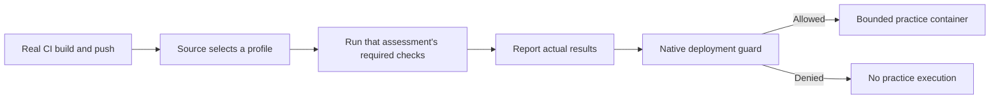

# Check and guard a real billing-api publishing job

Use BuildBarrel's shared workflow form to generate one complete CI file. This sample
only supplies check/deployment commands and suggested values. The initial image responds to `/health`, but calculates no
tax on `/invoice`: Development's smoke check passes; Production's integration
check fails and its deployment guard refuses to run the practice container.



## Connect a repository before publishing

The practice checkout deliberately removes `origin`. From anywhere inside the
checkout, choose a new isolated branch (use another name if it already exists):

```sh
cd "$(git rev-parse --show-toplevel)"
git remote -v
git switch -c buildbarrel-image-practice
```

Create an **empty private repository** in your CI provider without a README,
license or .gitignore. With an authenticated GitHub CLI, the equivalent is
`gh repo create OWNER/REPOSITORY --private`, replacing OWNER/REPOSITORY with your
chosen name. Alternatively use an existing private practice repository and a
fresh branch, especially when its existing runner is restricted to that repository.
Never replace or force-push an existing branch. Add a dedicated remote:

```sh
(
  set -eu
  printf 'Practice repository Git URL: '
  read -r PRACTICE_REPO_URL
  test -n "$PRACTICE_REPO_URL"
  if git remote get-url practice >/dev/null 2>&1; then
    test "$(git remote get-url practice)" = "$PRACTICE_REPO_URL" || {
      printf '%s\n' 'Remote practice already points elsewhere. Keep it; choose another unused remote name throughout these instructions.'
      exit 1
    }
  else
    git remote add practice "$PRACTICE_REPO_URL"
  fi
  git remote get-url --push practice
  git branch --show-current
)
```

Confirm the printed **push** URL is the intended repository, including any
separately configured push URL. Resolve authentication using your provider's Git
setup; never embed a token in the URL. Existing remotes remain untouched.
Do not push until the job, policy, credentials and cleanup below are ready.

Enter the repository, **Publishing branch**, and **Workflow file**
`.github/workflows/buildbarrel-images.yml` once in the GitHub connection form. BuildBarrel
uses the saved branch for the generated push trigger and editable policy preset.
The workflow file identity authenticates publishing; the source policy decides
which profile the real event and branch may select. For Generic CI, enter the
branch in the source rule and configure that branch in your existing provider.
Never turn a manual or scheduled event into a push.

Record credential **identifiers**, never values: this copy's checkout management
and publish key names/prefixes, and its new account device token's prefix,
creation time and expiry. Compare account Access tokens before and after
checkout; the device label ends with ` (demo copy)`.

## Prepare the shared workflow

1. Set up this Application's image storage and wait for **Storage ready**.
   Create the CI connection for your repository. Generic CI also needs a
   publisher key saved as `BUILDBARREL_PUBLISHER_KEY` in the existing provider secret
   store. This grants publishing only.
2. In **Profiles**, choose **Edit profiles → Use billing-api example**.
   Development requires smoke; Production requires smoke and integration.
   The GitHub source rule uses your saved publishing branch. Review the exact
   connection, branch, event `push` and Production choice before saving.
   **Use publishing branch** can fill an existing GitHub rule. Generic CI starts
   unclassified: enter your intended branch and explicitly choose Production.
3. Create separate Application-bound API tokens with bounded expiry:
   `BUILDBARREL_VALIDATION_TOKEN` needs `image.read` and `image.validation.report`;
   `BUILDBARREL_READ_KEY` needs `image.read`. Save their values only in the provider's
   secret store. Record their names, prefixes, Application and creation time
   for exact revocation later. Generation does not create or authorize tokens.
4. Open the connection's **Generate your workflow** form and choose
   **Use billing-api sample commands**. Review these choices:

   | Field | Sample value |
   |---|---|
   | Build directory | `project/billing/application/billing-api` |
   | Dockerfile | `Dockerfile` |
   | Profile | Production, chosen explicitly |
   | API smoke command | `python3 ci/check.py smoke` |
   | API integration command | `python3 ci/check.py integration` |
   | Deployment command | `python3 ci/practice-deploy.py` |
   | Command cleanup | Empty; each sample command removes its own container |
   | Job timeout | 10 minutes |

5. Choose labels for an **existing** runner with Python 3.10+, Git, curl, jq,
   Docker access and routes to BuildBarrel and Harbor. For GitHub inspect repository
   **Settings → Actions → Runners**. Generic CI also needs GNU `timeout`.
   Keep Docker on the runner's approved isolated engine. Runner provisioning
   is outside this tutorial.
6. Choose **Generate configuration**, then download or copy the complete file
   to `.github/workflows/buildbarrel-images.yml` (or your approved path). For Generic
   CI, run the complete shell script from the checkout root in your existing
   provider job, with the real source/run variables mapped as shown.

The file already includes the push trigger, secret references, preflight,
publishing, revision labeling, source report, validation results, native guard
and cleanup. There is no separate guard file, revision-stamping command,
helper invocation or YAML fragment to insert. The shared executor is embedded
using a compressed standard-library bootstrap; the file has no runtime download
of a separate tool. Commands run from the build directory with the immutable
`BUILDBARREL_IMAGE_REFERENCE` and `BUILDBARREL_IMAGE_DIGEST`. Catalog definitions are pinned:
changed required checks require workflow regeneration. The final native guard
still reads current policy immediately before the deployment command.

The workflow runs these checks inline. An enabled hook claiming a required check
must be resolved first so that each check has one execution owner. Ordinary hooks
remain available for a separate receiver, outside this inline workflow.

Preflight prints PASS or actionable FAIL in the real CI log before requesting
publishing credentials. A queued job has not run: check runner availability,
repository access, matching labels and whether Actions is enabled. Ask the
runner operator to restore availability. Passing preflight proves reachability,
not publishing permission. Keep the generated cleanup: it ends the session and
removes its temporary Docker configuration. A generic job needs the generated
three-minute termination allowance for the complete workflow in the provider's outer timeout. Runner loss or
forced termination can still need the session reaper and operator cleanup.

## Make the first publishing push

Only after all configuration above is saved, keep `billing.json` at `tax_rate`
0.00 and run from the checkout. For Generic CI substitute its workflow path:

```sh
cd "$(git rev-parse --show-toplevel)"
git status --short
git diff
git remote get-url --push practice
git branch --show-current
git add .github/workflows/buildbarrel-images.yml
git diff --cached
git commit -m "billing: connect practice image CI"
git push --set-upstream practice HEAD
```

Review the staged diff before committing; stop for secrets or unrelated files.
If the remote rejects an existing branch, choose a fresh branch and update its
connection branch, regenerate the workflow, and review its policy. Never force-push. This push sets the upstream
used by the correction's `git push`. The package workflow is separate.

The helper waits at most 90 seconds
for discovery and the assessment belonging to this connection, digest, commit,
run, attempt and job. It uses that assessment's exact validation UUIDs and rejects
definitions that differ from the generated workflow. The sample commands pull the immutable reference and run small containers
without network or host mounts, The shared executor reports their real exit outcomes through normal APIs.

The guard still runs after a recorded check failure. A JSON line with
`kind: "buildbarrel_image_workflow_receipt"` records its exit code and whether the
practice command ran. This is CI output from that actual invocation, not server
progress or deployment proof manufactured by the tutorial. A denied guard must
have `command_executed: false`. An allowed guard immediately wraps a short-lived
application container, checks `/health`, removes it and records its actual exit
code. Reused terminal check results are labelled `execution_mode: "recorded"`,
`replayed: true`, and `executed: false`; they are not a new container execution.
For an executed command, the receipt's source and CI run fields come from the
exact normal source record and the assessment exported by the guard. On denial,
actual assessment/source fields stay null: the separately labelled preflight
read cannot prove which assessment the guard observed. A replay against another
connection or run is refused. This practice execution
publishes no host port and leaves no running service.

## Fix the invoice and publish again

Return to the Application directory:

```sh
cd "$(git rev-parse --show-toplevel)/project/billing/application/billing-api"
python3 -c "import json; from pathlib import Path; p=Path('billing.json'); p.write_text(json.dumps({'tax_rate': 0.20}) + '\n')"
git add billing.json
git commit -m "billing: apply twenty percent tax"
git push
```

The new revision's image returns a subtotal of 100, tax of 20 and total of 120.
Its own Production assessment must pass both real checks before the fresh guard
allows the practice container. The earlier failed image and attempts remain in
BuildBarrel. The manual course's `/health` smoke behavior is unchanged.

## Inspect a refusal or stop work

- `source_assessment_not_observed`: inspect the real publishing run, image
  discovery and connection. Confirm the invocation stays inside the source step.
- `source_did_not_select_requested_profile`: inspect the source's actual event
  and current source rules; do not relabel a manual event as a push.
- `requirements_changed_regenerate_workflow` or
  `check_definition_changed_regenerate_workflow`: review the current policy and
  regenerate the workflow with commands for every required definition.
- `validation_attempt_already_running`: inspect that run; use a provider job
  retry for a new attempt after cancellation, rather than executing the same
  claimed attempt twice.
- `guard_source_does_not_match_this_ci_run`: use the exact source's connection,
  commit, digest, run, attempt and job identifiers; do not reuse another run's receipt.
- `container_cleanup_incomplete`, `container_cleanup_timeout` or
  `container_cleanup_unavailable`: inspect the exact `container_name` emitted in
  the sample cleanup failure. Resolve it before retrying the job.
- `guard_execution_scope_changed`: the governing assessment changed between
  reads. No deployment command ran. Review the new assessment before retrying.
- `buildbarrel_http_401` or `buildbarrel_http_403`: check token expiry, Application scope,
  operations and the owner's current permissions. Leaving the copy removes
  that authority; do not retry against another tenant.
- A denied guard: inspect **Current policy** and the CI receipt. For a separate
  eligibility-only check, use the native profile's generated Deployment guard.
  An eligibility read is not proof that a deployment command executed.

## Verify both receipts and exit

Review the failing and successful `buildbarrel_image_workflow_receipt` records with
`execution_mode: real`. The failed receipt must name the failed digest and profile, return
a nonzero guard exit and `command_executed: false`. Its assessment/source fields
are null; diagnostic preflight fields do not establish the guard's assessment.
The successful receipt must match BuildBarrel's source_id, run_id, digest, profile
and actual assessment (also compare the provider run’s commit to BuildBarrel), with guard and command exit codes 0, execution true and
the sample's separate `buildbarrel_sample_runtime_receipt` showing `runtime_started:
true` and `cleanup_status: complete`. A workflow `cleanup_status: not_configured`
means no additional command-cleanup hook was selected; it does not assert that
arbitrary command-owned resources were inspected. The final publishing step must
also print PASS for session and temporary Docker configuration cleanup.

In the tutorial, under **What you saw in the CI logs**, tick both statements, then
select **Confirm**. **Confirmed** stores only acknowledgement metadata in this
browser, scoped to your account, copy and exact source/build/assessment/check
attempt identities. Refresh preserves it when storage is available; blocked
storage keeps it only until this page is refreshed or left. A different run or copy needs
its own review. Current eligibility remains independent: revocation still denies
execution. This acknowledgement grants no permission, ingests no receipt and
makes no server-verified execution claim.

Exit in this order:

1. Save both receipts and their provider run URLs outside the disposable copy.
2. Finish or cancel all practice jobs. Keep native session cleanup and inspect
   its result. The sample removes exact named containers on success, failure,
   interruption and timeout. Resolve a cleanup failure on that isolated runner.
3. Disable the practice workflow in the provider, then remove its read,
   validation and (Generic CI only) publisher secrets. Preserve unrelated jobs.
   The tutorial's external-cleanup checkbox records only learner confirmation.
4. Revoke this exact CI connection through BuildBarrel's Publishing page. In registry
   **Access tokens → Automation tokens**, revoke the checkout management and
   package publish keys and the two Application image keys. Match the names,
   prefixes, creation times and copy/Application scope recorded at creation.
   In account **Access tokens → Device tokens** (`/+app/settings/tokens`), revoke
   the exact new ` (demo copy)` device token. It is account-owned, survives copy
   deletion and otherwise remains valid until expiry. Preserve older devices;
   local logout or removing a cached token does not revoke it on the server.
5. Use the registry menu **Leave registry → Leave and delete**. This requests
   backend deletion of the private copy and its image storage. Returning to
   Discover confirms leaving, not completed deletion. Backend confirmation is
   the deletion workflow's `deleted` state including storage cleanup. If you
   cannot read it after leaving, ask the operator to verify the exact copy UUID.
   Your external repository and workflow are not deleted by BuildBarrel.
